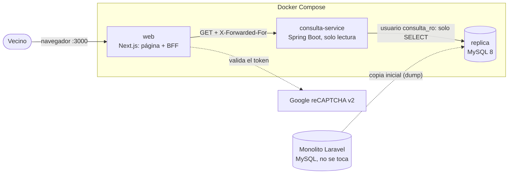
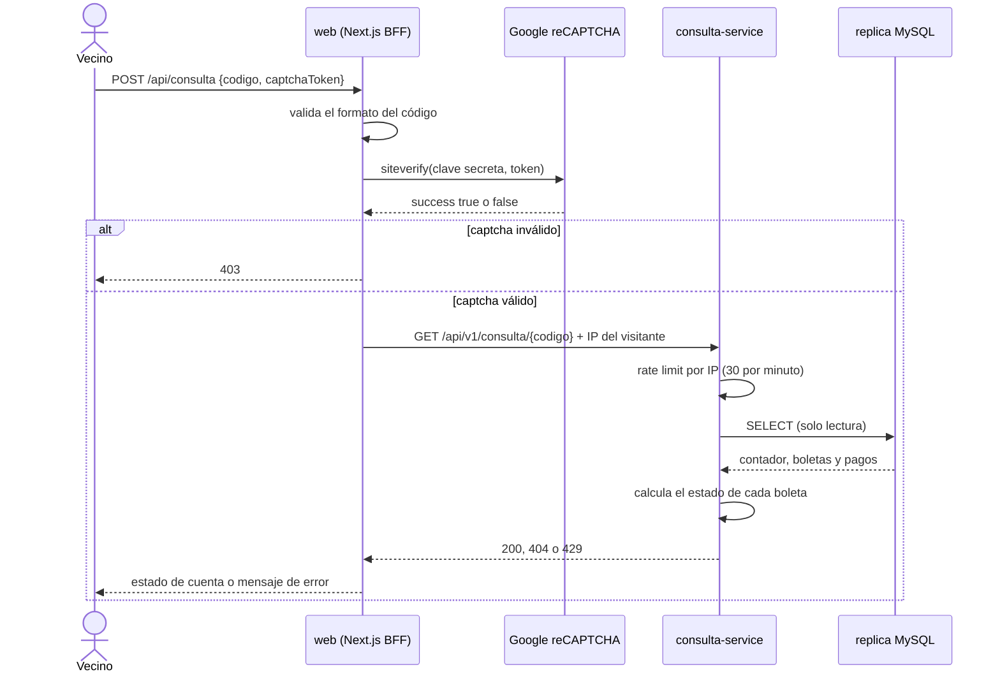

# Consulta pública de estado de cuenta

Oficina Municipal de Agua Potable · **Desarrollo Web 2026 · Fase 2 · Feature 1**

Página pública donde un vecino escribe el **código de su contador**, resuelve un captcha y ve su saldo,
sus boletas y sus últimos pagos. Se construye **al lado del monolito** (Laravel, Fase 1) sin modificarlo:
trabaja sobre una **réplica de solo lectura** de su base de datos.

## Arquitectura



Flujo de una consulta:



| Pieza | Tecnología | Responsabilidad |
|---|---|---|
| `web/` | Next.js 16, React 19, TypeScript | Página pública y **BFF** (`POST /api/consulta`): valida el captcha y llama al servicio |
| `consulta-service/` | Spring Boot 3.5, Java 17, JPA/Hibernate | API de solo lectura, cálculo de estados, rate limit |
| `replica` | MySQL 8.0 | Copia de las tablas del monolito que la consulta necesita |

## Cómo levantarlo

Requisito: **Docker Desktop** abierto y en estado *running*.

```powershell
git clone https://github.com/ByronEscobar49/consulta-publica.git
cd consulta-publica
copy .env.example .env
docker compose up -d --build
```

La primera vez tarda varios minutos (descarga imágenes y dependencias). Cuando `docker compose ps`
muestre los tres servicios como `healthy`, abre **http://localhost:3000**.

El `.env.example` trae las **claves de prueba públicas de Google** (el captcha siempre aprueba y muestra
un aviso rojo de "solo para pruebas"). Para producción hay que generar claves propias en
<https://www.google.com/recaptcha/admin> y ponerlas en `.env`.

Comandos útiles:

| Acción | Comando |
|---|---|
| Ver el estado | `docker compose ps` |
| Ver los registros de un servicio | `docker compose logs consulta-service --tail 40` |
| Apagar todo | `docker compose down` |
| Reconstruir solo la web | `docker compose up -d --build web` |
| Reiniciar la réplica desde cero | `docker compose down -v` y luego `docker compose up -d` |

## Datos de prueba

La réplica trae 7 contadores con distintas situaciones, para probar cada caso:

| Código | Situación | Saldo pendiente |
|---|---|---|
| `CTR-0001` | Al día (pagó julio, agosto y septiembre) | Q 0.00 |
| `CTR-0002` | Pago de agosto **revertido**: vuelve a deber esa boleta | Q 126.00 |
| `CTR-0003` | Agosto sin pagar | Q 70.00 |
| `CTR-0004` | Agosto con **pago parcial** | Q 153.00 |
| `CTR-0005` | Boleta de septiembre **anulada** (no cuenta en el saldo) | Q 0.00 |
| `CTR-0006` | Contador inactivo, sin boletas | Q 0.00 |
| `CTR-0007` | **Borrado lógico**: la API responde 404 | — |

Los saldos no cambian con el tiempo, pero el **estado** de cada boleta sí: pasa de *pendiente* a
*vencida* cuando llega su fecha de vencimiento. Todos los NIT, DPI y teléfonos son inventados.

## Contrato de la API

El contrato está **antes que el código** (*contract-first*):
[`consulta-service/src/main/resources/static/openapi/consulta-api.yaml`](consulta-service/src/main/resources/static/openapi/consulta-api.yaml).
Maven genera de él la interfaz y los DTOs de Java en cada compilación; esos archivos no se editan a mano.

```
GET /api/v1/consulta/{codigoContador}
  200  contador, titular abreviado, resumen de saldo, últimas 12 boletas y 12 pagos
  400  código con formato inválido
  404  no existe un contador activo con ese código
  429  demasiadas consultas desde esa IP (cabecera Retry-After)
```

El **estado de cada boleta se calcula**, no está guardado en la base del monolito:

1. **Anulada** si tiene fecha de anulación.
2. **Pagada** si los pagos no revertidos cubren su monto.
3. **Vencida** si no está pagada y su fecha de vencimiento ya pasó.
4. **Pendiente** en cualquier otro caso (incluye el mismo día del vencimiento).

## Decisiones de diseño

**Dos barreras contra el abuso, independientes.** El captcha solo protege la página: alguien puede llamar
a la API directamente sin pasar por ella, o resolver captchas con servicios automáticos. Por eso el
servicio aplica además un *rate limit* por IP.

- **Captcha:** lo valida el servidor de Next.js con la clave secreta, nunca el navegador. Sin captcha
  válido, la petición se corta antes de llegar al servicio. Cada token sirve una sola vez.
- **Rate limit:** ventana deslizante en memoria, 30 consultas por minuto por IP (configurable con
  `RATE_LIMIT_MAX_REQUESTS` y `RATE_LIMIT_WINDOW_SECONDS`). Al excederlo responde 429 con `Retry-After`.
  Es un contador por instancia: con varias réplicas del servicio habría que moverlo a algo compartido, como Redis.

**Solo lectura, por varios caminos a la vez.** El monolito no se toca.

- La base de datos usa un usuario (`consulta_ro`) con **solo `SELECT`** sobre 10 tablas; no ve `users`, `roles` ni `audits`.
- Los repositorios extienden `Repository` (no `JpaRepository`): no existen `save()` ni `delete()`.
- Las entidades son `@Immutable` y `ddl-auto` está en `validate`: Hibernate comprueba el esquema pero nunca lo modifica.

**Mínimo de datos personales.** Las entidades solo mapean las columnas necesarias: el NIT, el DPI, el
teléfono y el correo no pueden filtrarse porque ni siquiera se leen. El titular se muestra abreviado
(`María F. L. C.`).

**Redes separadas.** Solo `web` publica un puerto (3000). `consulta-service` no es alcanzable desde fuera de
Docker, y la web y la base de datos no comparten red: la web no puede ni resolver el nombre de la réplica.
Esto es lo que hace seguro que el servicio confíe en la cabecera `X-Forwarded-For` para saber la IP del visitante.

**Otras medidas.** Los contenedores no corren como root. Las claves nunca se copian a las imágenes
(`.dockerignore`) y la clave secreta se lee al arrancar, no al compilar. El navegador nunca recibe un
*stack trace* ni mensajes internos del servicio. Las respuestas llevan `Cache-Control: no-store`.

## Desarrollo local sin Docker

| Pieza | Cómo |
|---|---|
| Base de datos | Cualquier MySQL 8 con el esquema y los datos de `db/init/` y el usuario de `db/usuario-solo-lectura.sql` |
| Servicio | Abrir `consulta-service` en IntelliJ y ejecutar `ConsultaApplication` (puerto 8081; configurable con `DB_URL`, `DB_USERNAME`, `DB_PASSWORD`) |
| Web | `cd web`, copiar `web/.env.example` como `web/.env.local`, `npm install` y `npm run dev` (puerto 3000) |

## Pruebas

- **Servicio (22 pruebas unitarias):** en IntelliJ, *Maven → consulta-service → Lifecycle → test*, o `mvn test`.
  Cubren las reglas de estado de boleta, el formato del titular y la ubicación, el rate limit y la resolución de IP.
- **Web:** `cd web`, `npm run lint` y `npm run build`.

## Estructura del repositorio

```
consulta-publica/
├── consulta-service/            Microservicio Spring Boot
│   ├── src/main/resources/static/openapi/consulta-api.yaml    el contrato
│   ├── src/main/java/.../       controller, service, repository, entity, ratelimit
│   └── Dockerfile
├── web/                         Next.js: página pública y BFF
│   ├── src/app/api/consulta/    BFF: valida el captcha y llama al servicio
│   ├── src/components/          formulario, captcha y vista del estado de cuenta
│   └── Dockerfile
├── db/
│   ├── init/                    esquema, usuario base y datos de la réplica
│   ├── usuario-solo-lectura.sql usuario consulta_ro con solo SELECT
│   └── datos-prueba.sql         script con el que se generaron los datos de prueba en el monolito
├── docker-compose.yml
└── .env.example
```

## Regenerar la réplica desde el monolito

Los scripts de `db/init/` se obtuvieron de la base del monolito (aquí, un contenedor `monolito-mysql`).
Si cambia su esquema o sus datos hay que volver a sacarlos. Se hace dentro del contenedor y luego se copia
el archivo, porque redirigir con `>` en PowerShell genera archivos en UTF-16:

```powershell
docker exec monolito-mysql sh -c "mysqldump -uroot -proot --no-data --skip-comments --no-tablespaces gestion_agua > /tmp/esquema.sql"
docker cp monolito-mysql:/tmp/esquema.sql db\init\01-esquema.sql

docker exec monolito-mysql sh -c "mysqldump -uroot -proot --no-create-info --skip-comments --no-tablespaces --single-transaction gestion_agua sectores pajas tarifas periodos clientes predios contadores lecturas series_documento correlativos boletas metodos_pago pagos > /tmp/datos.sql"
docker cp monolito-mysql:/tmp/datos.sql db\init\03-datos.sql
```

No se copia la tabla `users` del monolito, porque guarda hashes de contraseñas: `db/init/02-usuario-base.sql`
crea un usuario mínimo para que las llaves foráneas tengan a quién apuntar. Después hay que reiniciar la
réplica con `docker compose down -v`, porque los scripts solo corren cuando el volumen está vacío.

## Limitaciones conocidas

- **La réplica es una copia inicial**, no una replicación en vivo: refleja la base del monolito en el momento del dump.
- Las **credenciales del `docker-compose.yml`** (`consulta_ro_pass`, `root-local`) son solo para desarrollo.
- Las **claves del captcha son las de prueba** de Google.
- El rate limit es **en memoria** (una sola instancia del servicio).
- Los **tipos de TypeScript** de la web (`web/src/lib/tipos.ts`) se mantienen a mano; si cambia el contrato
  hay que actualizarlos (a futuro podrían generarse con `openapi-typescript`).
- No hay pruebas automáticas de los repositorios ni del BFF; esas partes se probaron manualmente.
