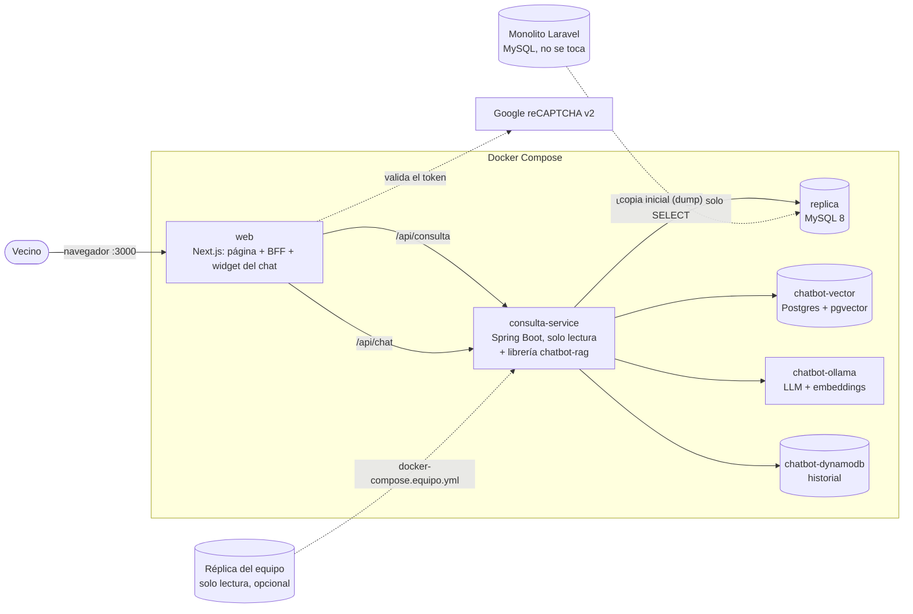
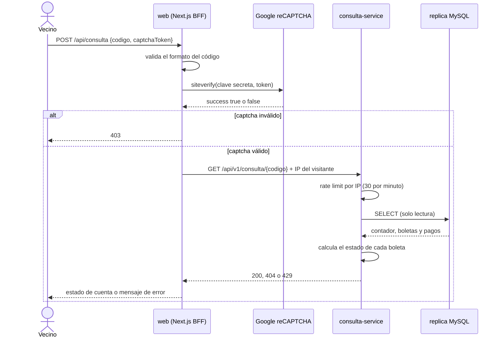
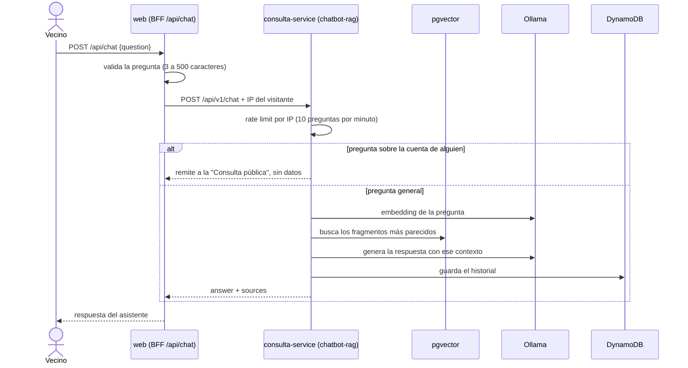

# Consulta pública de estado de cuenta (con asistente virtual)

Oficina Municipal de Agua Potable · **Desarrollo Web 2026 · Fase 2 · Feature 1** (consulta pública) **+ integración de la Feature 2** (chatbot RAG)

Página pública donde un vecino escribe el **código de su contador**, resuelve un captcha y ve su saldo,
sus boletas y sus últimos pagos. En la misma página hay un **asistente virtual** (chatbot con RAG) que
responde dudas generales: tarifas, formas de pago, trámites y qué hacer ante una fuga.

Se construye **al lado del monolito** (Laravel, Fase 1) sin modificarlo: trabaja sobre una
**réplica de solo lectura** de su base de datos.

## Arquitectura



Flujo de una consulta de estado de cuenta:



Flujo de una pregunta al asistente:



| Pieza | Tecnología | Responsabilidad |
|---|---|---|
| `web/` | Next.js 16, React 19, TypeScript | Página pública, **BFF** (`/api/consulta`, `/api/chat`) y widget del chat |
| `consulta-service/` | Spring Boot 3.5, Java 17, JPA/Hibernate + librería `chatbot-rag` | API de solo lectura, cálculo de estados, rate limit y chatbot |
| `replica` | MySQL 8.0 | Copia de las tablas del monolito que la consulta necesita |
| `chatbot-vector` | Postgres 16 + pgvector | Base vectorial del chatbot (conocimiento) |
| `chatbot-ollama` | Ollama (`qwen2.5:3b` y `bge-m3`) | Modelo de lenguaje y embeddings, corre local sin GPU |
| `chatbot-dynamodb` | DynamoDB Local | Historial de preguntas y respuestas |

## Cómo levantarlo

Requisitos: **Docker Desktop** abierto y en estado *running*, con unos **8 GB de RAM libres** (el
modelo de lenguaje corre en tu máquina) y unos **5 GB de disco**.

```powershell
git clone https://github.com/ByronEscobar49/consulta-publica.git
cd consulta-publica
copy .env.example .env
docker compose up -d --build
```

La primera vez tarda bastante: descarga imágenes, dependencias y, además, **los modelos de Ollama
(unos 3 GB)**. Cuando `docker compose ps` muestre todo como `healthy`, abre **http://localhost:3000**.

> **Si `consulta-service` se queda esperando mucho tiempo** (el log queda en `Pulling the 'bge-m3' model`),
> la descarga automática se atascó. Se resuelve descargando los modelos a mano y reiniciando el servicio:
>
> ```powershell
> docker compose exec chatbot-ollama ollama pull bge-m3
> docker compose exec chatbot-ollama ollama pull qwen2.5:3b
> docker compose restart consulta-service
> ```

El `.env.example` trae las **claves de prueba públicas de Google** (el captcha siempre aprueba y muestra
un aviso rojo de "solo para pruebas"). Para producción hay que generar claves propias en
<https://www.google.com/recaptcha/admin> y ponerlas en `.env`.

Comandos útiles:

| Acción | Comando |
|---|---|
| Ver el estado | `docker compose ps` |
| Ver los registros de un servicio | `docker compose logs consulta-service --tail 40` |
| Apagar todo | `docker compose down` |
| Reconstruir solo la web | `docker compose up -d --build web` |
| Reiniciar la réplica desde cero | `docker compose down -v` y luego `docker compose up -d` (borra también los modelos y el historial) |

## Usar la réplica del equipo

Por defecto todo corre contra la réplica local de Docker (códigos `CTR-0001`...`CTR-0007`). Opcionalmente se
puede apuntar el servicio a la **réplica compartida del equipo** (solo lectura, datos distintos, códigos
`CTRD-0001`...). Además, con esa réplica el chatbot puede leer las **tarifas, formas de pago y sectores reales**.

1. Agrega a tu `.env` (nunca al repositorio) las variables `EQUIPO_DB_URL`, `EQUIPO_DB_USERNAME`
   y `EQUIPO_DB_PASSWORD`. El `.env.example` trae el formato. Las credenciales las da quien administra la réplica.
2. Levanta con los dos archivos:

```powershell
docker compose -f docker-compose.yml -f docker-compose.equipo.yml up -d
```

Para volver a la réplica local: `docker compose up -d`.

En el log del servicio, la línea `Ingesta completada: 27 fragmentos FAQ, 6 del monolito` confirma que el
chatbot leyó los datos reales (con la réplica local dice `0 del monolito` y responde solo con las preguntas
frecuentes, porque el usuario de solo lectura local no incluye la tabla de tarifas).

## Datos de prueba

**Réplica local** (7 contadores con distintas situaciones):

| Código | Situación | Saldo pendiente |
|---|---|---|
| `CTR-0001` | Al día (pagó julio, agosto y septiembre) | Q 0.00 |
| `CTR-0002` | Pago de agosto **revertido**: vuelve a deber esa boleta | Q 126.00 |
| `CTR-0003` | Agosto sin pagar | Q 70.00 |
| `CTR-0004` | Agosto con **pago parcial** | Q 153.00 |
| `CTR-0005` | Boleta de septiembre **anulada** (no cuenta en el saldo) | Q 0.00 |
| `CTR-0006` | Contador inactivo, sin boletas | Q 0.00 |
| `CTR-0007` | **Borrado lógico**: la API responde 404 | — |

**Réplica del equipo** (algunos ejemplos):

| Código | Situación | Saldo pendiente |
|---|---|---|
| `CTRD-0001` | Al día, 10 boletas pagadas | Q 0.00 |
| `CTRD-0004` | 3 boletas con deuda (1 pendiente y 2 vencidas) | Q 151.20 |
| `CTRD-0005` | 10 boletas con deuda (1 pendiente y 9 vencidas) | Q 471.60 |

Los saldos no cambian con el tiempo, pero el **estado** de cada boleta sí: pasa de *pendiente* a
*vencida* cuando llega su fecha de vencimiento. Todos los NIT, DPI y teléfonos son inventados.

Preguntas de ejemplo para el chat: «¿Dónde puedo pagar?», «¿Cuánto cuesta la media paja?»,
«¿Qué hago si tengo una fuga?». Si se pregunta por el saldo de alguien, el chat no da datos y remite a la consulta.

## Contrato de la API

El contrato está **antes que el código** (*contract-first*):
[`consulta-service/src/main/resources/static/openapi/consulta-api.yaml`](consulta-service/src/main/resources/static/openapi/consulta-api.yaml).
Maven genera de él la interfaz y los DTOs de Java en cada compilación; esos archivos no se editan a mano.

```
GET /api/v1/consulta/{codigoContador}
  200  contador, titular abreviado, resumen de saldo, últimas 12 boletas y 12 pagos
  400  código con formato inválido
  404  no existe un contador activo con ese código
  429  demasiadas consultas desde esa IP (cabecera Retry-After)
```

El chatbot trae su propio contrato (`chatbot-api.yaml`, dentro de la librería) con `POST /api/v1/chat`
(`{"question": "..."}` → `answer` y `sources`).

El **estado de cada boleta se calcula**, no está guardado en la base del monolito:

1. **Anulada** si tiene fecha de anulación.
2. **Pagada** si los pagos no revertidos cubren su monto.
3. **Vencida** si no está pagada y su fecha de vencimiento ya pasó.
4. **Pendiente** en cualquier otro caso (incluye el mismo día del vencimiento).

## Decisiones de diseño

**Dos barreras contra el abuso, independientes.** El captcha solo protege la página: alguien puede llamar
a la API directamente sin pasar por ella, o resolver captchas con servicios automáticos. Por eso el
servicio aplica además un *rate limit* por IP.

- **Captcha:** lo valida el servidor de Next.js con la clave secreta, nunca el navegador. Sin captcha
  válido, la petición se corta antes de llegar al servicio. Cada token sirve una sola vez.
- **Rate limit:** ventana deslizante en memoria, 30 consultas por minuto por IP (configurable con
  `RATE_LIMIT_MAX_REQUESTS` y `RATE_LIMIT_WINDOW_SECONDS`). Al excederlo responde 429 con `Retry-After`.
  Es un contador por instancia: con varias réplicas del servicio habría que moverlo a algo compartido, como Redis.
  El chatbot aplica el suyo: 10 preguntas por minuto por IP.

**Solo lectura, por varios caminos a la vez.** El monolito no se toca.

- La base de datos usa un usuario (`consulta_ro`) con **solo `SELECT`** sobre 10 tablas; no ve `users`, `roles` ni `audits`.
- Los repositorios extienden `Repository` (no `JpaRepository`): no existen `save()` ni `delete()`.
- Las entidades son `@Immutable` y `ddl-auto` está en `validate`: Hibernate comprueba el esquema pero nunca lo modifica.
- El chatbot usa conexiones propias y la del monolito es de solo lectura; no toca las entidades de la consulta.

**Mínimo de datos personales.** Las entidades solo mapean las columnas necesarias: el NIT, el DPI, el
teléfono y el correo no pueden filtrarse porque ni siquiera se leen. El titular se muestra abreviado
(`María F. L. C.`). **El chatbot no tiene acceso a ninguna cuenta**: ante preguntas sobre saldos o pagos
de alguien, remite a la consulta pública (que sí exige captcha).

**Redes separadas.** Solo `web` publica un puerto (3000). `consulta-service`, la base vectorial, Ollama y
DynamoDB no son alcanzables desde fuera de Docker, y la web y las bases de datos no comparten red.
Esto es lo que hace seguro que el servicio confíe en la cabecera `X-Forwarded-For` para saber la IP del visitante.
También por eso el endpoint administrativo `/api/v1/ingest` de la librería del chatbot, que no tiene
autenticación, no es alcanzable: el BFF solo reenvía `/api/chat`.

**Integración del chatbot como librería.** La Feature 2 se entrega como librería Spring Boot
(`chatbot-rag-1.0.0.jar`) que se auto-configura al agregarla. Como no está en Maven Central, el `.jar` y su
`pom` viven en `consulta-service/libs/` y el Dockerfile los instala antes de compilar. Dos clases de este
servicio se renombraron (`ConsultaExceptionHandler`, `ConsultaRateLimitFilter`) porque chocaban de nombre
con las de la librería.

**Otras medidas.** Los contenedores propios no corren como root. Las claves nunca se copian a las imágenes
(`.dockerignore`) y la clave secreta se lee al arrancar, no al compilar. El navegador nunca recibe un
*stack trace* ni mensajes internos del servicio. Las respuestas llevan `Cache-Control: no-store`.

## Desarrollo local sin Docker

| Pieza | Cómo |
|---|---|
| Base de datos | Cualquier MySQL 8 con el esquema y los datos de `db/init/` y el usuario de `db/usuario-solo-lectura.sql` |
| Chatbot | Instalar la librería en Maven local (`mvn install:install-file -Dfile=consulta-service/libs/chatbot-rag-1.0.0.jar -DpomFile=consulta-service/libs/chatbot-rag-1.0.0.pom`) y levantar Postgres con pgvector, Ollama y DynamoDB Local en sus puertos por defecto (5433, 11434 y 8000) |
| Servicio | Abrir `consulta-service` en IntelliJ y ejecutar `ConsultaApplication` (puerto 8081; configurable con `DB_URL`, `DB_USERNAME`, `DB_PASSWORD`) |
| Web | `cd web`, copiar `web/.env.example` como `web/.env.local` (con `CONSULTA_API_URL` y `CHATBOT_SERVICE_URL` apuntando a `http://localhost:8081`), `npm install` y `npm run dev` (puerto 3000) |

## Pruebas

- **Servicio (22 pruebas unitarias):** en IntelliJ, *Maven → consulta-service → Lifecycle → test*, o `mvn test`.
  Cubren las reglas de estado de boleta, el formato del titular y la ubicación, el rate limit y la resolución de IP.
- **Web:** `cd web`, `npm run lint` y `npm run build`.

## Estructura del repositorio

```
consulta-publica/
├── consulta-service/            Microservicio Spring Boot
│   ├── src/main/resources/static/openapi/consulta-api.yaml    el contrato
│   ├── src/main/java/.../       controller, service, repository, entity, ratelimit
│   ├── libs/                    librería chatbot-rag (.jar y .pom) de la Feature 2
│   └── Dockerfile
├── web/                         Next.js: página pública, BFF y widget del chat
│   ├── src/app/api/consulta/    BFF: valida el captcha y llama al servicio
│   ├── src/app/api/chat/        BFF del chat: valida la pregunta y la reenvía
│   ├── src/components/          formulario, captcha, estado de cuenta y chat (components/chat)
│   └── Dockerfile
├── db/
│   ├── init/                    esquema, usuario base y datos de la réplica
│   ├── usuario-solo-lectura.sql usuario consulta_ro con solo SELECT
│   └── datos-prueba.sql         script con el que se generaron los datos de prueba en el monolito
├── docker-compose.yml           toda la pila: réplica, chatbot (3 servicios), servicio y web
├── docker-compose.equipo.yml    opcional: usar la réplica compartida del equipo
└── .env.example
```

## Regenerar la réplica desde el monolito

Los scripts de `db/init/` se obtuvieron de la base del monolito (aquí, un contenedor `monolito-mysql`).
Si cambia su esquema o sus datos hay que volver a sacarlos. Se hace dentro del contenedor y luego se copia
el archivo, porque redirigir con `>` en PowerShell genera archivos en UTF-16:

```powershell
docker exec monolito-mysql sh -c "mysqldump -uroot -proot --no-data --skip-comments --no-tablespaces gestion_agua > /tmp/esquema.sql"
docker cp monolito-mysql:/tmp/esquema.sql db\init\01-esquema.sql

docker exec monolito-mysql sh -c "mysqldump -uroot -proot --no-create-info --skip-comments --no-tablespaces --single-transaction gestion_agua sectores pajas tarifas periodos clientes predios contadores lecturas series_documento correlativos boletas metodos_pago pagos > /tmp/datos.sql"
docker cp monolito-mysql:/tmp/datos.sql db\init\03-datos.sql
```

No se copia la tabla `users` del monolito, porque guarda hashes de contraseñas: `db/init/02-usuario-base.sql`
crea un usuario mínimo para que las llaves foráneas tengan a quién apuntar. Después hay que reiniciar la
réplica con `docker compose down -v`, porque los scripts solo corren cuando el volumen está vacío.

## Limitaciones conocidas

- **La réplica local es una copia inicial**, no una replicación en vivo: refleja la base del monolito en el momento del dump.
- Las **credenciales del `docker-compose.yml`** (`consulta_ro_pass`, `root-local`, `chatbot`) son solo para desarrollo.
- Las **claves del captcha son las de prueba** de Google.
- El rate limit es **en memoria** (una sola instancia del servicio).
- El chatbot corre un **modelo pequeño en CPU**: la primera respuesta puede tardar y, como todo modelo de
  lenguaje, puede equivocarse; las cifras de tarifas conviene verificarlas con las fuentes que muestra.
- Con la réplica local, el chatbot responde solo con las preguntas frecuentes; para tarifas reales hace falta
  la réplica del equipo.
- Los **tipos de TypeScript** de la web (`web/src/lib/tipos.ts`) se mantienen a mano; si cambia el contrato
  hay que actualizarlos (a futuro podrían generarse con `openapi-typescript`).
- No hay pruebas automáticas de los repositorios, del BFF ni de la integración del chatbot; esas partes se probaron manualmente.
